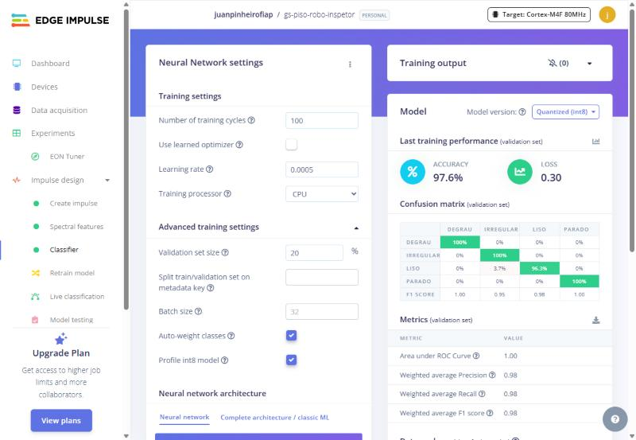
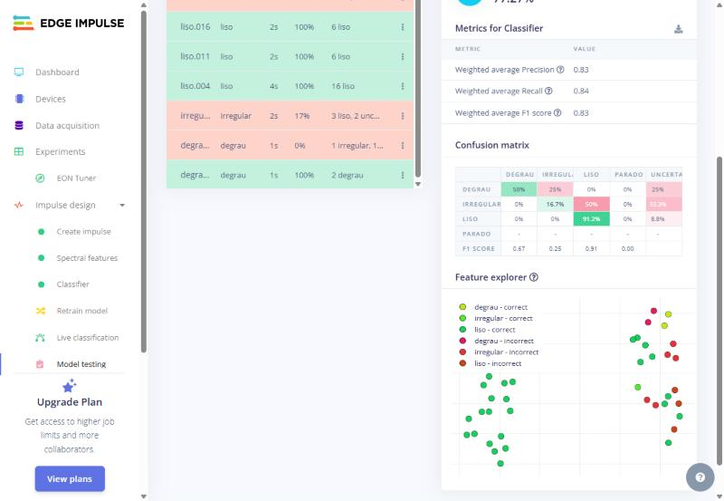

# Global Solution CitizenTech — Robô Inspetor de Acessibilidade

[← Voltar ao README](../README.md)

Documentação técnica da entrega da **Global Solution 2026.2** em **Project-Based Maker Lab** (componente *Físico* do MVP do grupo): a evolução do carrinho-robô para identificar e registrar barreiras de acessibilidade em calçadas, corredores e rampas.

> **Status dos testes:** onde aparece ⏳, o item foi escrito e compila, mas ainda **não foi validado no carrinho**. A tabela da seção 9 é atualizada conforme os testes são feitos.

## 1. Problema

Calçadas e passagens públicas têm obstáculos, degraus, pisos irregulares e rampas íngremes demais. Para quem usa cadeira de rodas, muleta ou anda com dificuldade, qualquer um deles pode impedir a circulação. Esses problemas costumam só ser conhecidos quando alguém reclama, porque inspecionar trecho por trecho dá trabalho.

- **Cidadão:** pessoas com deficiência ou mobilidade reduzida e idosos, e quem cuida da manutenção desses espaços (agentes públicos).
- **Território:** ambiente urbano (calçadas, corredores, praças, prédios públicos).

## 2. Solução

Um robô de baixo custo percorre o trecho **sozinho (modo patrulha)** ou conduzido por um controle, e **registra cada barreira** com o tipo e o momento em que apareceu. No fim, imprime um **relatório** com o total de ocorrências por tipo.

| O robô detecta | Com que sensor | Como decide |
|---|---|---|
| **Obstáculo no caminho** | HC-SR04 (ultrassônico) | distância média abaixo de 20 cm |
| **Rampa acima da norma** | MPU-6050 (acelerômetro) | inclinação acima de 8,33% por 1 s |
| **Piso irregular** | MPU-6050 + modelo de TinyML | 3 de 5 respostas do modelo dizem "irregular" |
| **Degrau** | MPU-6050 + modelo de TinyML | resposta "degrau" com confiança de 60% ou mais |
| **Carrinho tombado** | MPU-6050 | inclinação acima de 45° por 0,5 s |

O limite de 8,33% (1:12) é a referência de inclinação máxima de rampas da NBR 9050; vale conferir a edição vigente da norma antes de citá-lo.

## 3. Componentes

| Componente | Função |
|---|---|
| **ESP32-WROOM-32 DevKit V1** | controlador, roda o modelo de TinyML |
| **Ponte H L298N** e 4 motores DC | movimento (jumpers ENA/ENB: velocidade máxima) |
| **HC-SR04** | distância (obstáculos) |
| **MPU-6050 (GY-521)** — *sensor adicional* | aceleração e giro: inclinação, vibração do piso, batidas e curvas |
| **Controle de PS4** (Bluepad32) | direção manual, ligar a patrulha e pedir o relatório |
| **Buzzer ativo** | avisos sonoros e buzina |
| 4 pilhas AA (motores) e USB ou power bank (ESP32) | alimentação |

### Ligação

| Peça | Pino da ESP32 |
|---|---|
| L298N IN1, IN2, IN3, IN4 | GPIO 25, 26, 27, 14 |
| HC-SR04 TRIG | GPIO 18 |
| HC-SR04 ECHO | GPIO 19, **por divisor de tensão** (1 kΩ + 2 kΩ), porque o ECHO manda 5 V e a ESP32 só aguenta 3,3 V |
| MPU-6050 SDA, SCL | GPIO 21, 22 (VCC no 3V3) |
| Buzzer (+) | GPIO 4 (o outro fio no GND) |
| Botão BOOT (liga/desliga a patrulha) | GPIO 0 (já está na placa) |

- O eixo **X** do MPU-6050 aponta para a **frente** do carrinho.
- A placa só tem 2 pinos GND. O GND do L298N vai direto na ESP32, e o do sensor, do MPU e do buzzer saem de um trilho de GND numa protoboard.

## 4. Como o sensor adicional e a IA se integram

```text
MPU-6050 ──(I2C, 200 leituras/s)──► tarefa de leitura (FreeRTOS, a cada 5 ms)
                                      │
                      ┌───────────────┼──────────────────────┐
                      ▼               ▼                      ▼
              janela de 1 s       gravidade filtrada     giro acumulado em Z
              (3 eixos, 200 amostras)  (passa-baixa)      (curvas da patrulha)
                      │               │
                      ▼               ▼
        Spectral Analysis (39 características)   inclinação, rampa e tombo
                      │
                      ▼
        rede neural 20 → 10 → 4 classes (int8)
                      │
                      ▼
   liso | irregular | degrau | parado ──► regras ──► ocorrências ──► relatório
                                              └────► decisões da patrulha
```

- **A leitura é feita numa tarefa só dela, a cada 5 ms certinhos.** O modelo foi treinado com dados a 200 Hz; se as leituras atrasassem, ele veria uma vibração diferente da que aprendeu. O eco do ultrassônico é medido por interrupção pelo mesmo motivo: a tarefa do MPU interrompe o programa principal e uma medida por `pulseIn()` sairia errada.
- **O modelo só roda quando o carrinho anda para a frente** e depois dos primeiros 1,2 s da arrancada, que é o mesmo cenário dos dados de treino. Parado, a classe é "parado"; em ré ou girando, o piso fica "desconhecido".
- **Quem decide não é só o modelo:** a resposta passa por um histórico das últimas 5 respostas e por uma confiança mínima de 60%, para uma leitura isolada não gerar falso alerta.

### Por que a distância não usa o modelo antigo
O Check Point anterior treinou outro modelo no Edge Impulse (3 classes de distância). **Duas bibliotecas do Edge Impulse não podem ficar no mesmo programa**: as duas trazem o mesmo código interno (`run_classifier` é definida num arquivo de cabeçalho e as duas usam o mesmo `_INFERENCE_H`), o que dá erro de definição duplicada. Por isso, neste programa a distância usa os mesmos limites de 20 e 60 cm. No teste do Check Point 2, o modelo antigo concordou com esses limites em 92,7% das leituras.

## 5. Dados

Os dados do modelo de piso são **experimentais, gerados pelo próprio robô** em pisos de teste, e não vêm de uma fonte pública. A coleta e as escolhas estão em [`dados/gs-piso/`](../dados/gs-piso/README.md).

| Classe | Como foi coletada | Corridas usadas |
|---|---|---|
| `liso` | piso liso da casa, trecho fixo | 19 |
| `irregular` | tapete e papelão amassado | 7 |
| `degrau` | régua atravessada no caminho | 8 |
| `parado` | motores desligados | 3 |

- Foram **37 amostras** (1 min 20 s de dados) a 200 leituras por segundo, nos eixos X, Y e Z do acelerômetro.
- **5 corridas foram descartadas** porque o carrinho girou ou bateu na parede. O critério usa o giroscópio (desvio do giro em Z acima de 8 graus/s) e não o nível de vibração, para não escolher os dados pela resposta que se espera do modelo. O motivo de cada uma está em [`dados/gs-piso/descartadas/LEIA-ME.md`](../dados/gs-piso/descartadas/LEIA-ME.md).
- A coleta foi feita num único tipo de carrinho, com pilhas num certo estado de carga, em poucos pisos. **Os resultados não se generalizam sem novas coletas.**

## 6. Modelo (Edge Impulse)

- **Projeto público:** <https://studio.edgeimpulse.com/public/1167661/live>
- Janela de **1000 ms**, passo de 200 ms, 200 Hz, eixos accX, accY e accZ. Bloco *Spectral Analysis* (39 características) e rede densa 20 → 10 → 4 classes.
- 100 ciclos, learning rate 0,0005, balanceamento de classes ligado, versão **Quantized (int8)**.
- Na ESP32 (estimativa do Edge Impulse): 19 ms de processamento do sinal, 1 ms da rede, 3 KB de RAM, 15 KB de flash.

| Medida | Resultado | Observação |
|---|---|---|
| Validação (janelas dos arquivos de treino) | **97,6%** de acurácia, loss 0,30 | otimista: janelas vizinhas do mesmo arquivo caem em treino e validação |
| **Teste (7 corridas que o modelo nunca viu)** | **77,3%** | só 1 corrida de irregular e 2 de degrau |
| Teste offline do grupo (uma corrida inteira de fora por vez, kNN simples) | 93,6% | resultado de outra técnica, citado só como referência |

Acertos no teste por classe: `liso` 91%, `degrau` 50%, `irregular` 17%, `parado` sem amostras. **O ponto fraco é o piso irregular.**




## 7. Autonomia e decisões (modo patrulha)

△ no controle ou o botão BOOT da placa ligam e desligam a patrulha. Em patrulha o carrinho **não obedece ao analógico**.

| Situação | O que o robô faz |
|---|---|
| Caminho livre | anda para a frente |
| Obstáculo a menos de 20 cm | para, registra a ocorrência, **gira cerca de 90° medidos pelo giroscópio** e segue |
| Degrau detectado | para por 1,5 s (aviso sonoro) e segue |
| Rampa acima de 8,33% | registra, para e gira para outro caminho |
| Piso irregular | registra e continua |
| Tombado | desliga os motores e apita até ficar de pé de novo |
| ✕ no controle | emergência: para e sai da patrulha |

**Relatório:** o botão **Options** do controle imprime na serial o tempo de inspeção, o total de ocorrências por tipo e as últimas 40, cada uma com o tempo, a distância e a inclinação.

## 8. Como instalar e executar

1. **Arduino IDE** com o pacote de placas **ESP32 + Bluepad32** (versão 4.1.0). Em *Arquivo > Preferências > URLs adicionais*, acrescente:
   ```text
   https://raw.githubusercontent.com/ricardoquesada/esp32-arduino-lib-builder/master/bluepad32_files/package_esp32_bluepad32_index.json
   ```
2. Instale a **biblioteca do modelo**: *Sketch > Incluir Biblioteca > Adicionar biblioteca .ZIP* com [`dados/gs-piso/ei-gs-piso-robo-inspetor-arduino-1.0.1.zip`](../dados/gs-piso/).
3. Placa **ESP32 + Bluepad32 Arduino > DOIT ESP32 DEVKIT V1**. Abra [`src/arduino/gs_robo_inspetor`](../src/arduino/gs_robo_inspetor/gs_robo_inspetor.ino) e grave. **A primeira compilação leva uns 15 minutos** por causa da biblioteca do modelo; as seguintes são bem mais rápidas.
4. No Windows, a placa com chip CP2102 precisa do driver **CP210x** da Silicon Labs.
5. Ligue as pilhas dos motores e o USB (ou um power bank), **com o carrinho parado em piso plano**: no começo ele calibra o giroscópio e o nível (uns 3 segundos).
6. Segure **SHARE + PS** no controle até a luz piscar. Dirija com R2, L2 e o analógico.
7. Aperte **△** (ou o botão **BOOT**) para a patrulha. **Options** imprime o relatório no Monitor Serial (115200).

Para refazer a coleta de dados e o treino, veja [`dados/gs-piso/README.md`](../dados/gs-piso/README.md).

## 9. Testes e resultados

| Teste | Resultado |
|---|---|
| Leitura do MPU-6050 parado (X ≈ 0,2 g, Z ≈ 1,05 g, giro ≈ 0) | ✅ estável, 0 falhas de leitura em 200 leituras por segundo |
| Coleta de dados do piso com o carrinho | ✅ 37 amostras boas e 5 descartadas |
| Modelo com amostras nunca vistas | ✅ 77,3% (seção 6) |
| Programa final compila com o modelo real | ⏳ em andamento |
| Inclinação de rampa | ⏳ a validar com uma rampa de referência |
| Detecção de degrau e de piso irregular no carrinho | ⏳ a validar |
| Patrulha: desvio de obstáculo com giro de 90° | ⏳ a validar |
| Tombo | ⏳ a validar |
| Relatório pelo botão Options | ⏳ a validar |

### Falhas que aconteceram e como foram resolvidas

| Falha | Causa | Solução |
|---|---|---|
| Nenhum motor girava no primeiro teste | os dois fios de um mesmo motor estavam no mesmo borne da ponte H (motor em curto) | cada motor em dois bornes diferentes do par |
| Buzzer tocando o tempo todo | o fio (+) estava no 3V3, que fica sempre ligado | (+) no GPIO 4 e (−) no GND |
| O carrinho bateu na parede durante a coleta | trecho curto e corridas de 5 s | corridas de 3 s e ida e volta automática |
| Corridas "lisas" com vibração parecida com a do irregular | o carrinho girava e raspava na parede (giro Z acima de 8 graus/s) | critério do giroscópio para descartar |
| A COM8 sumiu durante uma gravação | conexão USB oscilou | tentar de novo; se repetir, trocar o cabo |
| Compilação com duas bibliotecas do Edge Impulse | símbolos duplicados | a distância passou a usar limites, sem o modelo antigo |

## 10. IA responsável e dados pessoais

- **Dados pessoais:** o robô **não tem câmera nem microfone** e não registra localização. Guarda apenas distância, inclinação, vibração e o horário da ocorrência. Nada sai do aparelho.
- **Como o modelo decide:** ele recebe só 1 segundo de vibração do carrinho e a descrição em frequências dessa vibração. Não "enxerga" o piso. Ele pode errar quando a vibração muda por outro motivo, como pilhas fracas, outra velocidade ou outro carrinho.
- **Vieses e limites:** poucos pisos, um só carrinho e poucas amostras de irregular e degrau (seção 5). As ocorrências são **sugestões para uma pessoa conferir**, e não um laudo.
- **Pessoa no circuito:** a patrulha liga e desliga por botão, e o ✕ para tudo na hora.

## 11. ODS

| ODS | Meta | Como o projeto contribui |
|---|---|---|
| **11 — Cidades e comunidades sustentáveis** | 11.7 (acesso a espaços públicos seguros, inclusivos e acessíveis, em especial para pessoas com deficiência e idosos) e, de forma complementar, 11.2 | identifica as barreiras que impedem o uso de calçadas e passagens por quem tem mobilidade reduzida |
| **10 — Redução das desigualdades** | 10.2 (inclusão de todos, independentemente da deficiência) | tira da invisibilidade barreiras que afetam um grupo específico |
| **9 — Indústria, inovação e infraestrutura** | 9.1 (infraestrutura de qualidade e acessível a todos) | um dispositivo de baixo custo e TinyML apoia a manutenção da infraestrutura urbana |

## 12. Limitações e próximos passos

- O piso **irregular** tem poucos dados e é a classe mais fraca. O próximo passo é coletar mais corridas, em pisos e velocidades variados, e separar o conjunto de teste por arquivo.
- Sem controle de velocidade (jumpers ENA/ENB), o carrinho anda sempre na velocidade máxima, e a vibração depende disso.
- O giro acumulado em Z desvia com o tempo (o MPU-6050 não tem bússola), então serve para curvas curtas.
- O relatório sai pela serial. Uma página pelo Wi-Fi ou o envio das ocorrências a uma plataforma seria o passo seguinte para encaixar o robô num sistema maior.
